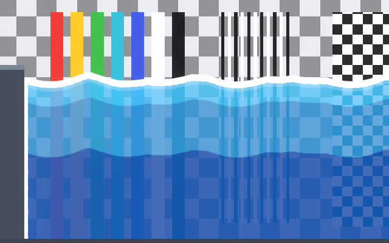

# Getting Started

This page assumes a URP project that uses the **2D Renderer** (for example, a project made from the
*Universal 2D* template). If yours doesn't, see [Pipeline Setup](pipeline-setup.md) first.

## 1. Create water

1. In the Hierarchy, choose **GameObject > 2D Object > Fluid > Water**.
2. A *Water* object appears at the center of the Scene view. It has:
   - **Fluid Body**: the mesh and the physics (floating, sinking, splashes);
   - **Fluid Surface Waves**: ripples when things fall in;
   - **Fluid Splash Particles** with a *WaterSplash* particle system as a child;
   - the **Water_Simple** material.
3. Drag the small handles on the edges in the Scene view to resize it. The object's position is the
   resting surface (the top edge); dragging the top handle moves the surface.

The other fluids come the same way, each ready with its own material, physics and particles:

| Menu | Prefab | What it adds |
|---|---|---|
| **GameObject > 2D Object > Fluid > Water** | `Prefabs/Fluids/Water` | Water_Simple, WaterSplash |
| **GameObject > 2D Object > Fluid > Lava** | `Prefabs/Fluids/Lava` | Lava_Painted, thick (objects sink slowly, light ones float high), LavaSplash, rising embers (Fluid Ambient Particles) and a 2D light that lights the surroundings (Fluid Glow Lights, URP only) |
| **GameObject > 2D Object > Fluid > Acid** | `Prefabs/Fluids/Acid` | Acid_Painted, a little thicker than water, AcidSplash |
| **GameObject > 2D Object > Fluid > Poison** | `Prefabs/Fluids/Poison` | Poison_Painted, thick, PoisonSplash |

The menu places an unpacked copy, so you can change anything on it. The Lava's glow light needs URP's
2D Renderer, like the shaders themselves. You can also drag the prefabs from
`Prefabs/Fluids` into the scene.

## 2. Pick a style

1. Select the water and look at its material in the Inspector.
2. Open **Style Preset** and choose a style. The list shows the preset materials by name, such as
   *Water_Cartoon* or *Water_Realistic*.
3. The shipped preset materials are shared. When you pick a style while the object still uses one of
   them, Unity asks what to do. Choose **Create a Copy** to get your own material, next to your scene
   (in `Assets` if the scene isn't saved yet).
   **Change the Preset** edits the shared preset itself.

See [Water Styles](water-styles.md) for each style and how to adapt it.

## 3. Press Play

Add any sprite with a **Rigidbody2D** and a **Collider2D** above the water and press Play. It
falls in, ripples and splashes.

- Give the sprite a **lower Sorting Order** than the water (for example -1), so the water draws in
  front of it and tints the part that is under the surface.
- Whether it floats depends on its density, mass ÷ area. A 1 × 1 sprite with the default mass of 1
  has a density of 1 and floats on the default fluid Density of 2. Set its mass to 4 and it sinks
  slowly. See [Physics](physics.md#floating-and-sinking).

## Next steps

- Tune each effect: [Water Effects](water-effects.md).
- Make objects float the way you want: [Physics](physics.md).
- See the water bend what's behind it: [Pipeline Setup — Refraction](pipeline-setup.md#refraction).
- Try the demo scenes in `Demo/Scenes`: [Demo Scenes](demo-scenes.md).
