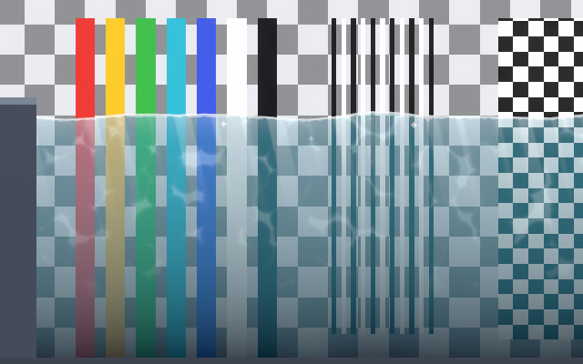

# Fluid Shaders 2D

Customizable 2D fluid shaders for Unity: water, lava, acid and poison. You place a fluid in your
scene, pick a style, and tweak material values until it matches your art. Cartoon, pixel art,
painted, realistic and flat styles all come from the same shaders.

**[Try the web demo](https://keyblee.github.io/2DFluidsShaderDocumentation/demo/)**: every fluid, style and effect, live in your browser (WebGL 2).

## What's in the pack

- **Water shader** with ten switchable effects: surface waves, reflection, light rays, bubbles,
  glints, wall foam, caustics, pixel art, bands and refraction. Eight style presets: Cartoon,
  Pixel Art, Painted, Realistic, Flat, Tropical, Swamp and Simple.
- **Lava shader**: a molten top band, plates of crust with glowing seams and veins, molten patches,
  self-lit glow with a pulse, a halo above the surface and bubbles that pop. Five style presets.
- **Toxic shader** for acid and poison: thick foam and froth, bubbles that pop, rising vapor and an
  optional glow. Five acid and five poison presets.
- **Ready prefabs** for Water, Lava, Acid and Poison, each with its own physics (lava is thick) and
  particles; the lava adds rising embers and a 2D light that lights its surroundings.
- **Fluid Body** component: builds the mesh, makes objects float, sink and splash.
- **Interactive ripples** and **splash particles** (round, or square for pixel art).
- **Two demo scenes**, one with a live editor panel for every fluid that also works in player builds.

## Requirements

- Unity 2022.3 LTS or Unity 6.
- Universal Render Pipeline with the **2D Renderer** (2D lights supported).
- URP 3D and the Built-in pipeline: coming soon.

## Contents

| Page | Read it to… |
|---|---|
| [Getting Started](getting-started.md) | put a fluid in your scene in two minutes |
| [Water Effects](water-effects.md) | learn every setting of the water material |
| [Water Styles](water-styles.md) | match the water to your art style |
| [Lava Effects](lava-effects.md) | learn every setting of the lava material |
| [Lava Styles](lava-styles.md) | match the lava to your art style |
| [Toxic Effects](toxic-effects.md) | learn every setting of the acid and poison material |
| [Acid and Poison Styles](toxic-styles.md) | match acid and poison to your art style |
| [Fluid Body](fluid-body.md) | size the fluid, use ripples, splashes and the scripting API |
| [Physics](physics.md) | tune floating, sinking, currents and collisions |
| [Pipeline Setup](pipeline-setup.md) | set up URP 2D and refraction |
| [Presets](presets.md) | use, create and switch style presets |
| [Performance](performance.md) | keep the fluids cheap, especially on mobile |
| [Demo Scenes](demo-scenes.md) | explore the demos and the live editor panel |
| [Troubleshooting](troubleshooting.md) | fix common problems |

## Support

Online documentation: https://keyblee.github.io/2DFluidsShaderDocumentation/

Questions or problems: use the contact on the Asset Store page. Please include your Unity
version, render pipeline and a screenshot.
