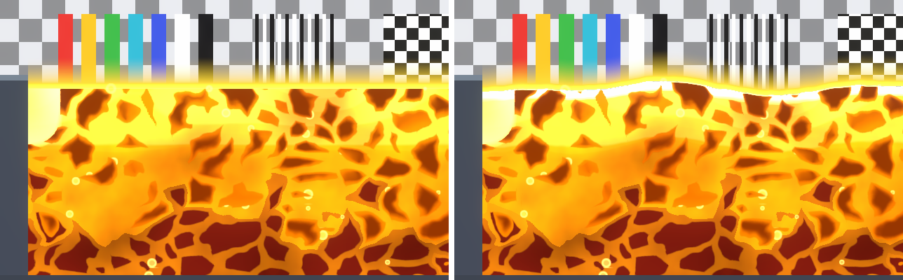
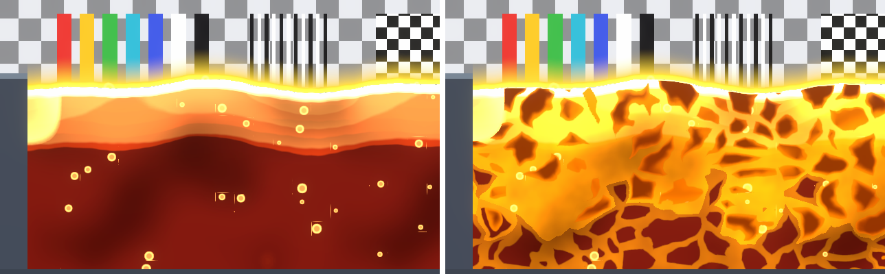
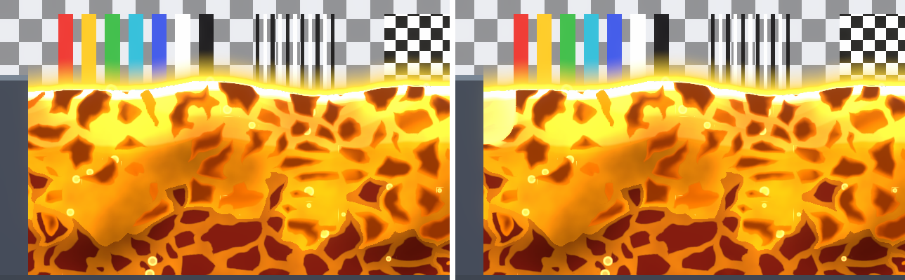
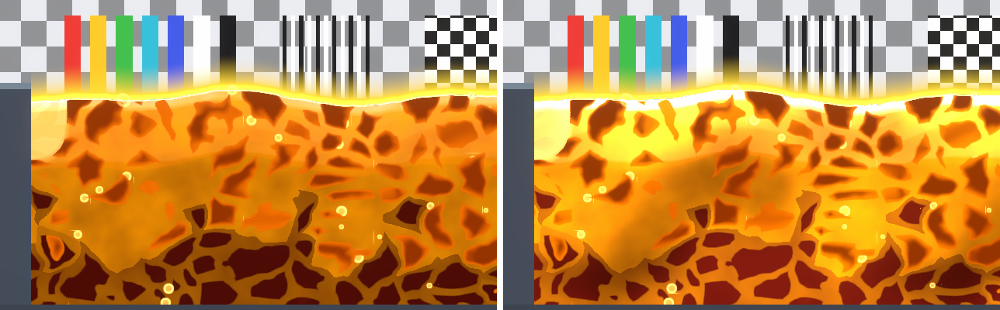
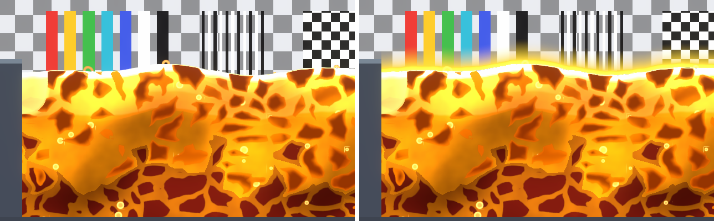
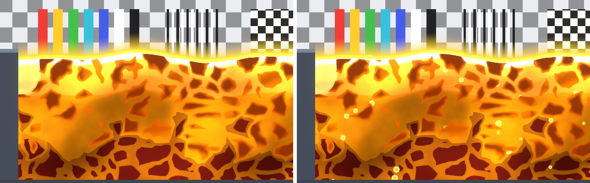
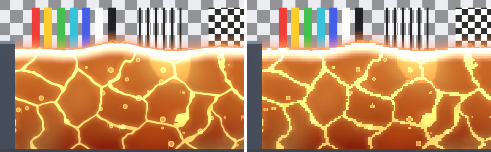
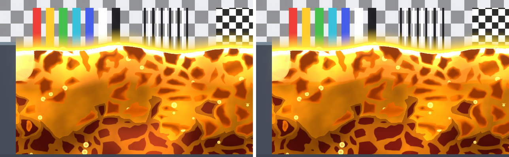

# Lava Effects

Every setting of the **Lava** shader (`SebastianEscobar/FluidShaders2D/Lava`), in inspector order. See [Water Effects](water-effects.md) for the shared parts.

## Colors

The heat ramp, from the molten top to the cool depths. With Emission on, these colours glow on their own.

| Property | What it does | Default | Typical |
|---|---|---|---|
| Surface Color (HDR) | Colour of the Surface Band, the molten top. Its alpha is the band's opacity. | (1, 0.96, 0.62) | Pale yellow; HDR above 1 for strong bloom |
| Hot Color (HDR) | Warm patches in the body and the Molten patches. | (1, 0.78, 0.18) | Yellow-orange |
| Mid Color | The body just under the band. | (0.98, 0.42, 0.06) | Orange |
| Deep Color | The body at Depth Fade Distance and below. | (0.62, 0.1, 0.03) | Dark red; near black for Realistic |
| Opacity | Fades the whole lava, glow included. | 1 | 1 |
| Depth Fade Distance | Depth in world units where Mid Color has turned into Deep Color. | 2 | 1.5–3 |

Cost: math only.

## Surface

Waves, the bright Surface Band and a thin rim on the line.

| Property | What it does | Default | Typical |
|---|---|---|---|
| Wave Height | Height of the waves, world units. | 0.08 | 0.05–0.15 |
| Wave Length | Distance between crests, world units. | 5 | 3–6 |
| Wave Speed | How fast the waves travel. | 0.3 | 0.2–0.5 |
| Wave Irregularity | Noise added to the waves so they never repeat. | 0.5 | 0.3–0.7 |
| Wave Sharpness | 0 rounded sine, 1 pointed crests. | 0 | 0; 0.6–0.8 for Cartoon |
| Surface Band Width | Depth of the molten band under the line, world units. It fades into the body (hard steps with Bands on). 0 removes it. | 0.3 | 0.2–0.45 |
| Highlight Color (HDR) | The thin incandescent rim on the line. Alpha is its opacity. | (4, 2.4, 0.9) | |
| Highlight Thickness | Rim thickness, world units. 0 removes it. | 0.02 | 0.02–0.07 |

Cost: 1 sample (noise for the waves).

## Noise

One detail sample drives the slow changes in the body: warm patches, the cell warp, the seam glow breakup and the pulse phase.

| Property | What it does | Default | Typical |
|---|---|---|---|
| Noise Texture | The shared FluidNoise texture. | FluidNoise | Keep |
| Noise Scale | Size of the slow patterns: smaller values give bigger patches. Also the wave irregularity. | 0.15 | 0.1–0.25 |
| Noise Speed | How fast the patches drift. | 0.02 | 0.01–0.05 |

Cost: 1 sample (the detail lookup every slow pattern shares).

## Flow

Moves the inner pattern (patches, plates, molten, bubbles) in one direction, like a lava river. The surface line stays.

| Property | What it does | Default | Typical |
|---|---|---|---|
| Flow Direction | Direction in degrees: 0 right, 90 up, 180 left. | 0 | |
| Flow Speed | World units per second. | 0.12 | 0.05–0.2 |

Cost: math only.

## Crust

Plates of cooled rock with glowing seams, one plate per procedural cell. Plates grow and melt away smoothly: a plate never pops in or out.

| Property | What it does | Default | Typical |
|---|---|---|---|
| Crust Color | Plate colour. Lit by 2D lights, so plates stay dark at night. | (0.2, 0.06, 0.04) | Near black for dark slabs, orange for glowing ones |
| Crust Amount | How much of the crust layer is covered by plates: 0 none, 1 all. | 0.85 | 0.7–0.95 |
| Crust Opacity | How much the plates cover the lava: 1 solid plates, 0.3 a faint darker tint (AI Quest style). | 1 | 0.3–1 |
| Cell Size | Plate width, world units. | 0.8 | 0.7–1.7; about 1 for 16 PPU pixel art |
| Cell Stretch | Makes plates wider than tall (1 round): flat slabs read best from the side. | 1.6 | 1–1.8 |
| Cell Warp | Bends the cell grid with the noise so plates are irregular. | 0.6 | 0.35–1 |
| Cell Drift | How far plates wander around their place. 0 still. | 0.2 | 0.15–0.45 |
| Crack Width | Width of the glowing seams. 0 removes them. Pixel Art keeps them at least one art pixel wide. | 0.12 | 0.05 thin – 0.25 wide |
| Crack Glow (HDR) | Seam colour. With Emission on, Glow Intensity lifts it further. | (1, 0.55, 0.12) | |
| Veins | Seams where there is no plate: 0 none (open lava is clean), 1 a full network of glowing veins. | 0.4 | 0 – 1 |
| Crust Rim Heat | Plate edges warmer than their core (1 none). | 1.6 | 1.3–2 |
| Crust Depth | Depth in world units of the crust layer under the surface, fully covered. | 0.5 | 0.25 top only – 100 whole body |
| Crust Fade | Distance below Crust Depth over which plates shrink to nothing. | 1.5 | 0.5–3 |

For a crust only along the top, use a small Crust Depth and Crust Fade (for example 0.25 and 0.5). For plates through the whole body, use a large Crust Depth.

Cost: one 3×3 cell search per pixel (nine hashes and distances), no texture sample. The heaviest part of the lava on mobile: turn Crust off on low-end devices.

## Molten

Large, slow patches where the lava is hotter and the plates melt away from their edges.

| Property | What it does | Default | Typical |
|---|---|---|---|
| Molten Color (HDR) | Colour of the patches. With Emission on, Glow Intensity lifts them a little. | (1.2, 0.8, 0.25) | |
| Molten Amount | How much of the lava is molten: 0 none, 1 all (removes every plate). | 0.45 | 0.15–0.5 |
| Molten Scale | Size of the patches, world units. | 6 | 5–9 |
| Molten Softness | 0 hard edges, 1 a wide hot gradient into the lava. | 0.4 | 0 cartoon – 0.6 painted |
| Molten Opacity | How strongly the patches take Molten Color. | 0.7 | 0.5–0.8 |

Cost: 2 samples (a second, turned lookup hides the texture repeat).

## Emission

The lava glows on its own and lights nothing. With Emission off, it is lit like a sprite (and the glowing parts are split by Light Effects Glow).

| Property | What it does | Default | Typical |
|---|---|---|---|
| Emission Strength | Glow of the whole body. | 1 | 1 |
| Glow Intensity | Extra glow on the hot parts only (band, seams, Molten patches), less deep down, so Bloom picks them out. | 1.8 | 0.6 Flat – 3 Realistic |
| Pulse Speed | Cycles per second of the breathing glow. | 0.3 | 0.25–0.3 |
| Pulse Amount | How much it breathes (0 steady). The phase changes across the lava. | 0.12 | 0–0.15 |

Cost: math only.

## Heat Glow

Light above the surface: a soft halo and a tight flare on the line.

| Property | What it does | Default | Typical |
|---|---|---|---|
| Glow Color (HDR) | Halo colour; alpha is its strength. | (2, 0.6, 0.1, 0.6) | |
| Glow Height | Halo height above the line, world units. | 0.6 | 0.5–0.7 |
| Edge Flare | A tighter, brighter halo hugging the waves. 0 none. | 0.5 | 0.5–0.7 |

Near the line the halo is opaque: without HDR the output is clamped before blending, so the halo covers as much as its brightest channel to keep its colour. Sprites right behind the hottest part of the halo are replaced by its light.

The Fluid Body grows its mesh to fit the halo.

Cost: math only; the mesh grows to fit the halo.

## Bubbles

Fat bubbles that rise under the plates and pop at the surface.

| Property | What it does | Default | Typical |
|---|---|---|---|
| Bubble Color (HDR) | Bubble and pop colour; alpha is their strength. | (3, 1.2, 0.3, 0.8) | |
| Bubble Size | Bubble radius, world units. | 0.08 | 0.07–0.09 |
| Bubble Density | Share of places with a bubble. | 0.2 | 0.15–0.25 |
| Bubble Rise Speed | World units per second. | 0.25 | 0.2–0.3 |
| Bubble Wobble | Sideways sway, world units. | 0.02 | 0–0.02 |
| Bubble Spread | Moves each bubble up or down inside its slot, so they do not line up in rows. | 1 | 1 |
| Bubble Speed Variation | Gives each column its own rise speed (±). 0 all rise together. | 0.4 | 0.3–0.5 |
| Pop Size | Radius of the ring when a bubble bursts at the line. | 0.15 | 0.12–0.18 |

With Emission off, bubbles and pops are lit like the rest.

Cost: math only.

## Pixel Art

Same as water; seams and pops are at least one art pixel.

| Property | What it does | Default | Typical |
|---|---|---|---|
| Pixels Per Unit | Art pixels per world unit; match your sprites. | 16 | |

Cost: math only.

## Bands

Same as water: flat colour steps. Also steps the Surface Band and the Molten patch edges.

| Property | What it does | Default | Typical |
|---|---|---|---|
| Bands | Number of colour steps. | 4 | 2–4 |
| Band Softness | 0 hard steps, 1 smooth. | 0 | 0 |

Cost: math only.

## Lighting

| Property | What it does | Default | Typical |
|---|---|---|---|
| Light Effects Glow | With Emission off: how much of the seams, bubbles and rim glow instead of being lit (0 lit, 1 glow). | 0 | 0–0.5 |

Lava has no Refraction: the lava is opaque, so there is nothing to see through.
| Ignore 2D Lights | Draws the lava unlit. | Off | |

Cost: Ignore 2D Lights skips the light lookup.

