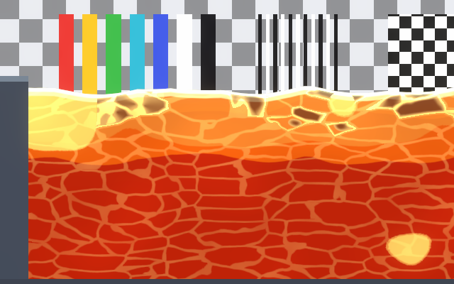
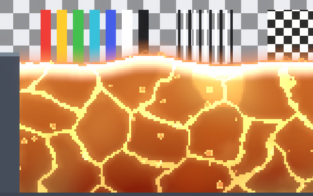
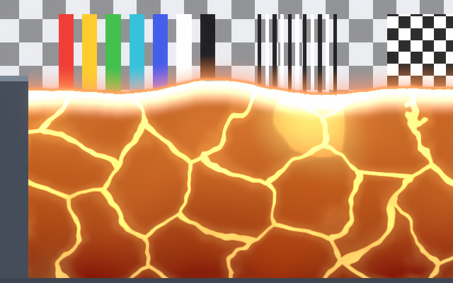
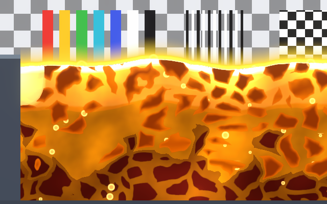
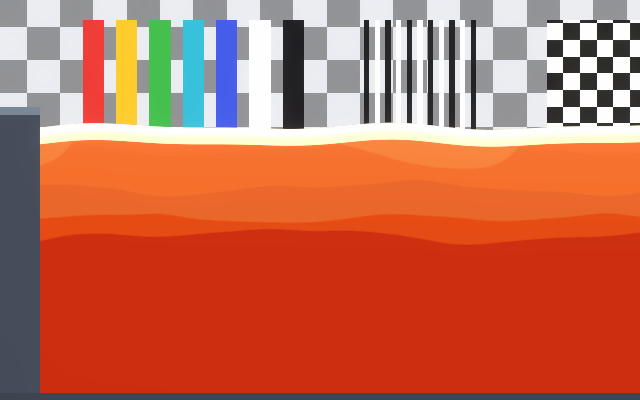

# Lava Styles

Each preset is a finished look and a starting point. Pick the closest one with **Style Preset** in the
material inspector, then adjust it to your art (see [Presets](presets.md) for how presets work). Effect
names below are the switches described in [Lava Effects](lava-effects.md).

| Preset | Effects on |
|---|---|
| Cartoon | Surface, Flow, Crust, Molten, Emission, Bands |
| Pixel Art | Surface, Flow, Crust, Molten, Emission, Heat Glow, Bubbles, Pixel Art |
| Painted | Surface, Flow, Crust, Molten, Emission, Heat Glow |
| Realistic | Surface, Flow, Crust, Molten, Emission, Heat Glow, Bubbles, Bands |
| Flat | Surface, Emission, Bands |

General advice for every style:

- **Use HDR and Bloom.** Lava is made to glow: with a Bloom volume the band, seams and molten patches
  shine; without HDR they clip to pale yellow.
- **Crust decides the read.** A thin layer at the top (small Crust Depth and Crust Fade) reads as a
  side view; plates through the whole body (large Crust Depth, low Crust Opacity) read as a lava lake.
- **Night scenes.** Keep Emission on: the lava then lights nothing by itself, so add the Lava prefab's
  Fluid Glow Lights to light the walls around it.

## Cartoon

A row of wide dark slabs on top, bold glowing seams, hard molten patches and three color bands.

- For a cleaner look, set Veins to 0 and raise Crack Width.
- Sharper crests (Wave Sharpness) suit the hard bands.

## Pixel Art

The crust, seams, bubbles and pops land on whole art pixels.

- Set **Pixels Per Unit** to your sprites' value. Seams stay at least one art pixel wide.
- Cell Size about 1 at 16 PPU keeps plates readable.

## Painted

Faint plates through the whole body with a network of glowing veins, a wide molten top and big soft
molten patches.

- Crust Opacity sets how much the plates show; Veins how much of the network glows.
- Molten Softness above 0.5 gives the patches a hot gradient.

## Realistic

Glowing slabs with wide seams, a strong pulse, rising bubbles and a halo above.

- Lower Pulse Amount for a calmer pool.
- Bubble Speed Variation keeps the bubbles from rising in step.

## Flat

Two flat color steps and a thin bright line: for minimal or UI-like art.

- Add Molten with Molten Softness 0 for flat hot patches.
