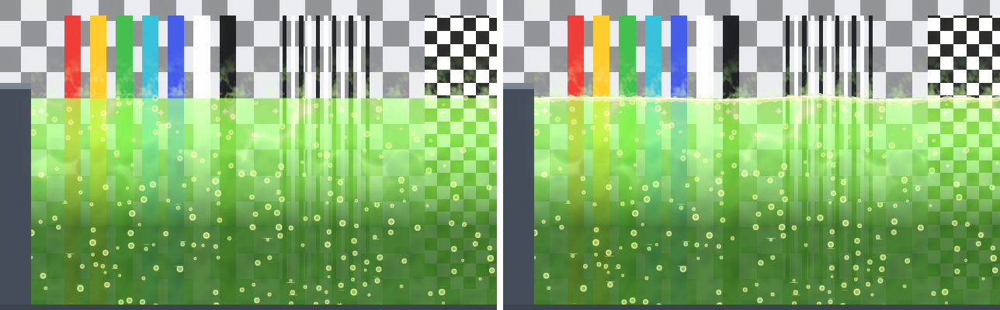
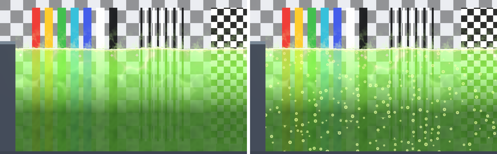
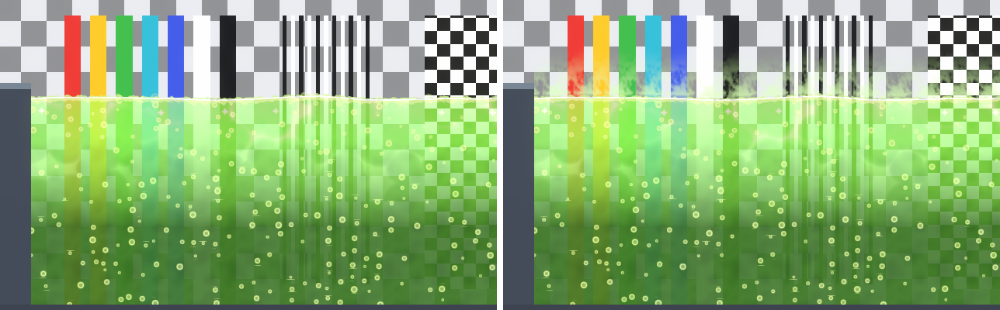
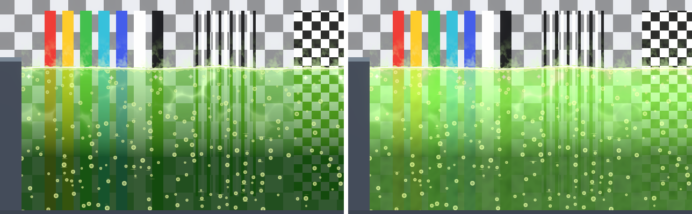
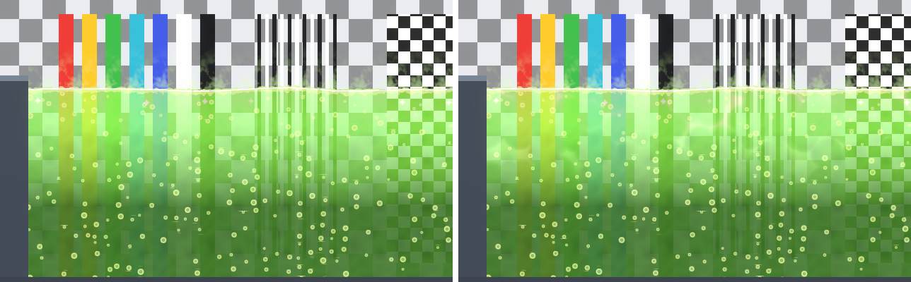
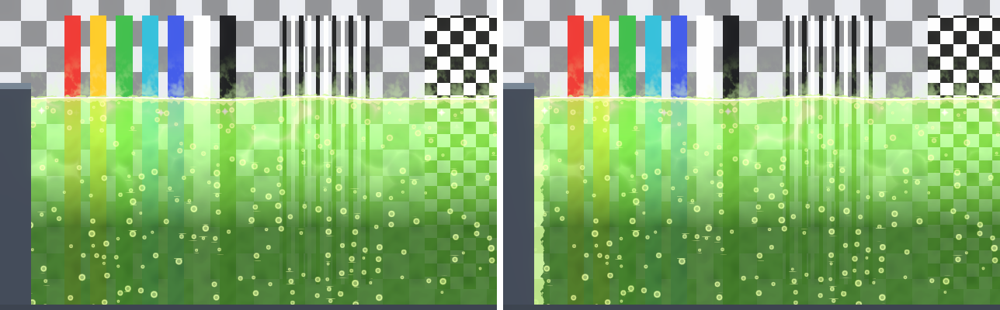
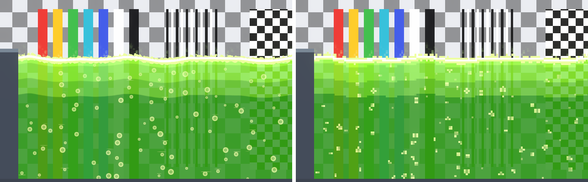
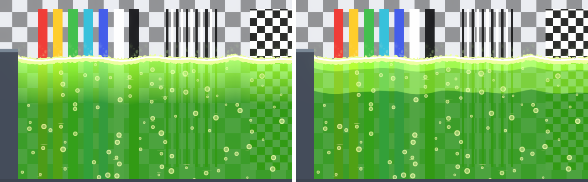
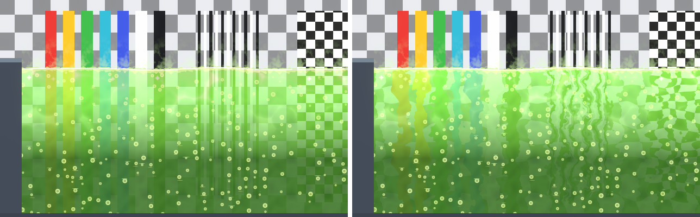

# Toxic Effects

Every setting of the **Toxic** shader (`SebastianEscobar/FluidShaders2D/Toxic`), shared by acid and poison: the presets choose the colours and amounts, no setting belongs to only one of them. See [Water Effects](water-effects.md) for the parts shared with water.

## Colors

As water.

| Property | What it does | Default | Typical |
|---|---|---|---|
| Shallow Color | Colour near the surface; alpha is how much of the background shows through. | (0.55, 0.95, 0.2, 0.75) | Acid yellow-green, poison purple |
| Deep Color | Colour at Depth Fade Distance and below. | (0.12, 0.42, 0.08, 0.95) | |
| Opacity | Fades the whole fluid. | 1 | 1 |
| Depth Fade Distance | Depth in world units where Shallow Color has turned into Deep Color. | 2 | 1.5–2.5 |

Cost: math only.

## Surface

Waves, a thin highlight and thick foam. Froth adds lumps of foam that sit on top of the line.

| Property | What it does | Default | Typical |
|---|---|---|---|
| Wave Height | Height of the waves, world units. | 0.06 | 0.03–0.08 |
| Wave Length | Distance between crests, world units. | 3 | 2.5–5 |
| Wave Speed | How fast the waves travel. | 0.6 | Acid 0.5–0.8, poison 0.25–0.35 |
| Wave Irregularity | Noise added to the waves so they never repeat. | 0.5 | 0.3–0.7 |
| Wave Sharpness | 0 rounded, 1 pointed crests. | 0 | 0; 0.6–0.7 for Cartoon |
| Highlight Color (HDR) | Thin bright line on the surface; alpha is its opacity. | (1, 1, 0.8) | |
| Highlight Thickness | Its thickness, world units. | 0.03 | 0.02–0.07 |
| Foam Color | Foam and froth colour; alpha is its opacity. | (0.85, 1, 0.55, 0.95) | |
| Foam Width | Depth of the foam band under the line, world units. Large values give a thick scum. | 0.25 | 0.12–0.3 |
| Foam Breakup | How lumpy the lower edge of the foam is. | 0.6 | 0.4–0.8 |
| Froth Height | Height of the foam lumps above the line, world units (lumps reach up to 1.3 ×). 0 none. | 0.08 | 0.06–0.14 |

Cost: 2 samples (noise for the waves, and for the foam and froth, shared with Wall Foam and the glow).

## Noise

Same as water.

| Property | What it does | Default | Typical |
|---|---|---|---|
| Noise Texture | The shared FluidNoise texture. | FluidNoise | Keep |
| Noise Scale | Size of the wave irregularity and foam lumps. | 0.25 | |
| Noise Speed | How fast they drift. | 0.08 | |

Cost: part of Surface.

## Bubbles

Bubbles that rise and burst at the surface with a short ring.

| Property | What it does | Default | Typical |
|---|---|---|---|
| Bubble Color | Bubble and ring colour; alpha is their strength. | (0.85, 1, 0.5, 0.8) | |
| Bubble Size | Radius, world units. | 0.06 | Acid 0.04–0.06, poison 0.07–0.09 |
| Bubble Density | Share of places with a bubble. | 0.3 | 0.3–0.4 |
| Bubble Rise Speed | World units per second. | 0.5 | Acid 0.6–0.8, poison 0.25–0.3 |
| Bubble Wobble | Sideways sway, world units. | 0.03 | |
| Bubble Spread | Moves each bubble up or down inside its slot, so they do not line up in rows. | 1 | 1 |
| Bubble Speed Variation | Gives each column its own rise speed (±). | 0.4 | |
| Pop Size | Radius of the ring when a bubble bursts at the line. | 0.12 | 0.1–0.16 |

Cost: math only.

## Vapor

Translucent puffs that rise from the surface and fade out. They are lit like the fluid (smoke, not light).

| Property | What it does | Default | Typical |
|---|---|---|---|
| Vapor Color | Colour; alpha is the strongest opacity. Keep it lighter than the background behind it. | (0.85, 1, 0.7, 0.45) | |
| Vapor Height | How high the vapor rises, world units. The Fluid Body grows its mesh to fit it. | 0.8 | 0.5–1.1 |
| Vapor Density | How much of the air is vapor. | 0.5 | Acid 0.4–0.6, poison 0.6–0.7 |
| Vapor Speed | Rise speed, world units per second. | 0.3 | 0.15–0.4 |
| Vapor Scale | Puff size, world units. | 0.6 | 0.5–0.8 |

Cost: 1 sample; the mesh grows to fit the vapor.

## Emission

The fluid glows on its own, strongest near the top, and breathes.

| Property | What it does | Default | Typical |
|---|---|---|---|
| Emission Color (HDR) | Glow colour. | (0.6, 1.4, 0.2) | |
| Emission Strength | Glow amount. Keep it low by day: it washes out the colours. | 0.4 | 0.2–0.4 |
| Pulse Speed | Cycles per second. | 0.4 | 0.3–0.5 |
| Pulse Amount | How much it breathes; the phase changes across the fluid. | 0.2 | 0.2–0.25 |

Cost: math only (uses the foam sample).

## Caustics

Moving light patterns on the body, as in water. They read as a chemical shimmer; keep them faint.

| Property | What it does | Default | Typical |
|---|---|---|---|
| Caustics Color (HDR) | Colour of the light pattern. | (0.8, 1, 0.5) | |
| Caustics Intensity | Brightness. | 0.6 | 0.4–0.6 |
| Caustics Scale | Size of the pattern (smaller is bigger). | 0.15 | |
| Caustics Speed | How fast it moves. | 0.3 | |
| Caustics Depth Fade | Depth in world units where it has faded out. | 2 | |
| Caustics Sharpness | 1 soft, 8 thin bright lines. | 4 | |

Cost: 2 samples, as water.

## Glints

Small sparkles near the surface, as in water.

| Property | What it does | Default | Typical |
|---|---|---|---|
| Glint Color (HDR) | Sparkle colour. | (2, 3, 1.5) | |
| Glint Density | How many sparkles. | 0.5 | |
| Glint Size | Sparkle size, world units. | 0.08 | |
| Glint Speed | How fast they twinkle. | 2 | |
| Glint Depth | How deep under the line they appear, world units. | 0.6 | |

Cost: math only.

## Wall Foam

Foam along the sides of the body that touch a wall (Fluid Body > Wall Foam Sides), as in water. It uses Foam Color.

| Property | What it does | Default | Typical |
|---|---|---|---|
| Wall Foam Width | Width of the foam along the wall, world units. | 0.25 | |
| Wall Foam Breakup | How lumpy its inner edge is. | 0.6 | |

Cost: math only (uses the foam sample).

## Pixel Art

Same as water; froth, vapor and pops land on whole art pixels.

| Property | What it does | Default | Typical |
|---|---|---|---|
| Pixels Per Unit | Art pixels per world unit; match your sprites. | 16 | |

Cost: math only.

## Bands

Same as water: flat colour steps of the body.

| Property | What it does | Default | Typical |
|---|---|---|---|
| Bands | Number of colour steps. | 4 | 2–4 |
| Band Softness | 0 hard steps, 1 smooth. | 0 | 0 |

Cost: math only.

## Refraction

Same as water: bends the background inside the fluid. Only inside: froth, vapor and pops are not bent.
Needs [refraction support](pipeline-setup.md#refraction).

| Property | What it does | Default | Typical |
|---|---|---|---|
| Refraction Strength | How far the background is bent (screen units). | 0.015 | 0.01–0.02 |
| Refraction Scale | Size of the distortion. | 0.5 | |
| Refraction Speed | How fast it moves. | 0.2 | |

Cost: 2 samples (distortion and the background).

## Lighting

| Property | What it does | Default | Typical |
|---|---|---|---|
| Light Effects Glow | How much of the caustics, glints and highlight glow instead of being lit (0 lit, 1 glow). | 0 | 0–0.6 |
| Ignore 2D Lights | Draws the fluid unlit. | Off | |

Cost: Ignore 2D Lights skips the light lookup.

