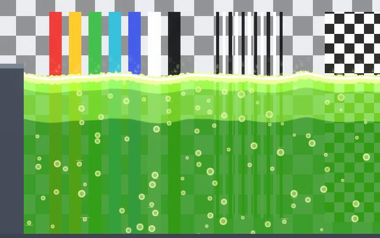
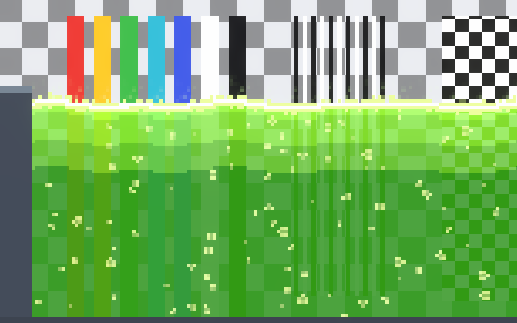
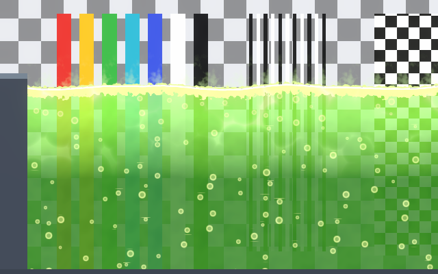
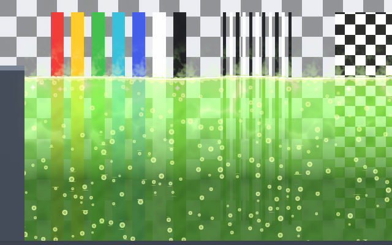
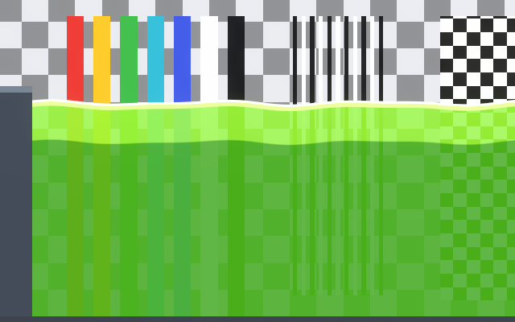
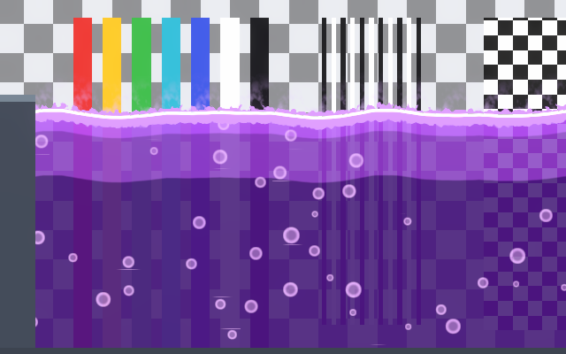
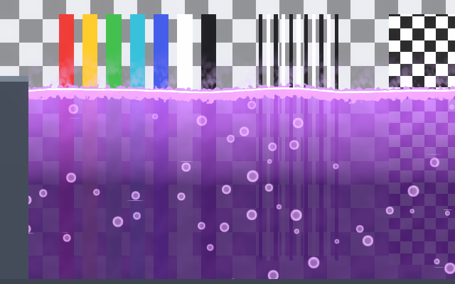
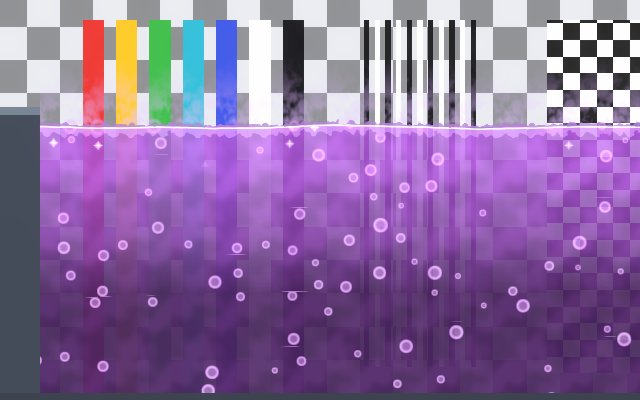
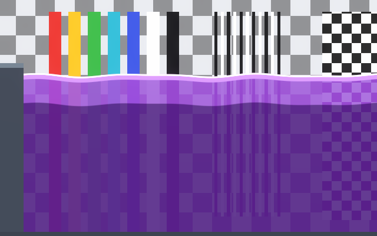

# Acid and Poison Styles

Acid and poison are presets of the same **Toxic** shader: any acid preset becomes a poison by changing
its colors and slowing it down. Pick the closest one with **Style Preset** in the material inspector,
then adjust it to your art (see [Presets](presets.md)). Effect names below are the switches described
in [Toxic Effects](toxic-effects.md).

| Preset | Effects on |
|---|---|
| Acid Cartoon, Poison Cartoon | Surface, Bubbles, Vapor, Bands |
| Acid Pixel Art, Poison Pixel Art | Surface, Bubbles, Vapor, Pixel Art, Bands |
| Acid Painted | Surface, Bubbles, Vapor, Emission, Caustics |
| Poison Painted | Surface, Bubbles, Vapor, Emission |
| Acid Realistic | Surface, Bubbles, Vapor, Emission, Caustics, Glints |
| Poison Realistic | Surface, Bubbles, Vapor, Emission, Glints |
| Acid Flat, Poison Flat | Surface, Bands |

General advice for every style:

- **Acid is fast, poison is thick.** Acid: small fast bubbles, quick waves, light vapor. Poison: big
  slow bubbles, slow waves, dense vapor. The prefabs match it with their drag.
- **Vapor lighter than the background.** Vapor is smoke, not light: a dark Vapor Color over a light
  background looks like dirt.
- **Emission by night.** Keep Emission Strength low by day (it washes the colors out); raise it for
  dark caves.

## Acid Cartoon

Bright yellow-green with three bands, pointed crests, lumpy froth and puffs of vapor.

## Acid Pixel Art

Froth, bubbles, pops and vapor land on whole art pixels. Set **Pixels Per Unit** to your sprites' value.

## Acid Painted

Soft translucent green with a faint glow and moving caustics.

## Acid Realistic

Darker, clearer acid with many small bubbles, glints and a stronger glow.

## Acid Flat

Two flat color steps and a thin foam line.

## Poison Cartoon

Purple with three bands, fat slow bubbles, tall froth and dense vapor.

## Poison Pixel Art

The pixel art version of the cartoon poison. Set **Pixels Per Unit** to your sprites' value.

## Poison Painted

Soft purple with a faint magenta glow and thick vapor.

## Poison Realistic

Deep, almost black purple, slow bubbles, glints and a magenta glow.

## Poison Flat

Two flat color steps and a thin foam line.
