# Water Effects

Every setting of the **Water** shader (`SebastianEscobar/FluidShaders2D/Water`), in the order the
material inspector shows them. Each effect has a switch in its header; turn it on, then expand the
foldout arrow to see its settings (they only show while the effect is on). An effect that is off
costs nothing.

Distances are in **world units**. Images show the effect **off (left)** and **on (right)** in the
showcase test room.

**Cost** counts texture samples per pixel (the main cost on mobile). Effects marked *math only* run
a few cheap instructions instead. Totals are in [Performance](performance.md).

## Colors

Always visible: the body of the water.

| Property | What it does | Default | Typical |
|---|---|---|---|
| Shallow Color | Color near the surface. Its alpha is how see-through the top of the water is. | light blue, alpha 0.6 | alpha 0.4–0.8 |
| Deep Color | Color at Depth Fade Distance and below. | dark blue, alpha 0.92 | alpha 0.8–1 |
| Opacity | Multiplies the transparency of the whole water, effects included. 0 makes it invisible (with Refraction on, only the bent background shows). | 1 | 0.6–1 |
| Depth Fade Distance | Depth where Shallow Color has fully turned into Deep Color. | 3 | 1–5 |

Cost: math only.

## Surface

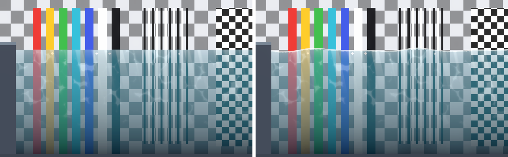

The animated surface line: waves, a bright highlight on the line and foam just below it. Turn
**Surface** off for a flat edge with no waves, highlight or foam (interaction ripples still move it).

| Property | What it does | Default | Typical |
|---|---|---|---|
| Surface | Turns the effect on. | on | |
| Wave Height | Height of the waves above and below the resting surface. | 0.08 | 0.03–0.2 |
| Wave Length | Distance between crests. | 3 | 1–6 |
| Wave Speed | How fast the waves travel. Negative values send the main wave left. | 1 | 0.3–2 |
| Wave Irregularity | Mixes in noise so crests differ from each other. | 0.5 | 0.2–0.8 |
| Wave Sharpness | 0 = smooth sine waves; 1 = pointed crests with rounded troughs (cartoon). | 0 | 0 or 0.6–1 |
| Highlight Color | Bright line on the surface. HDR: above 1 it glows with bloom. | white | |
| Highlight Thickness | Thickness of the highlight line. | 0.04 | 0.02–0.08 |
| Foam Color | Foam just under the surface (also used by Wall Foam). | white, alpha 0.9 | |
| Foam Width | Depth of the foam band. 0 hides it. | 0.2 | 0.05–0.4 |
| Foam Breakup | How patchy the foam is. 0 = solid band. | 0.6 | 0.3–0.8 |

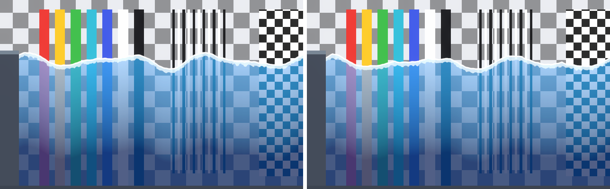

Tall waves are fine: the Fluid Body grows its mesh so crests are never cut flat.

Cost: 2 samples (noise for the waves and for the foam).

## Noise

The noise texture behind waves, foam and caustics. You rarely need to change it.

| Property | What it does | Default | Typical |
|---|---|---|---|
| Noise Texture | Tiling noise. R drives the waves, G the foam, B the caustics, A the refraction. The pack ships *FluidNoise*. A custom one must be RGBA, tileable, with Wrap Mode *Repeat* and sRGB off. | FluidNoise | |
| Noise Scale | Size of the noise pattern. Smaller = larger features. | 0.25 | 0.1–0.5 |
| Noise Speed | How fast the noise drifts. | 0.1 | 0.05–0.3 |

Your own noise texture survives a change of style: presets that use the pack's *FluidNoise* keep
yours.

## Reflection

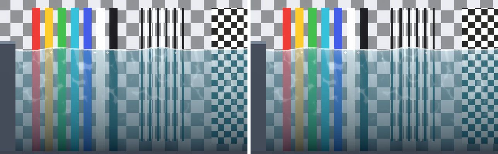

A light band under the surface that fades with depth, like the sky reflected on the water.

| Property | What it does | Default | Typical |
|---|---|---|---|
| Reflection | Turns the effect on. | off | |
| Reflection Color | Color of the band. | pale blue | |
| Reflection Depth | How far down the band reaches. | 0.6 | 0.3–1.5 |
| Reflection Strength | How visible the band is. | 0.5 | 0.2–0.7 |

Cost: math only.

## Light Rays

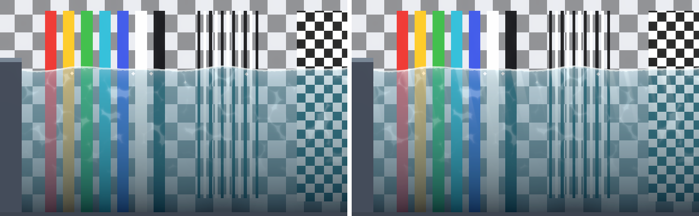

Slanted shafts of light entering from the surface and fading towards the bottom.

| Property | What it does | Default | Typical |
|---|---|---|---|
| Light Rays | Turns the effect on. | off | |
| Rays Color | Color of the rays. HDR. | warm white | |
| Rays Intensity | Brightness. | 0.35 | 0.2–0.8 |
| Rays Angle | Tilt in degrees. 0 = straight down. | 15 | -30–30 |
| Rays Density | Rays per world unit. | 1.5 | 0.8–3 |
| Rays Width | Width of the rays: near 0 they almost vanish, 1 = almost solid light. | 0.4 | 0.2–0.6 |
| Rays Speed | How fast the rays sway. | 0.2 | 0.1–0.5 |
| Rays Depth Fade | Depth where the rays have faded out. | 2.5 | 1–4 |

Cost: math only.

## Bubbles

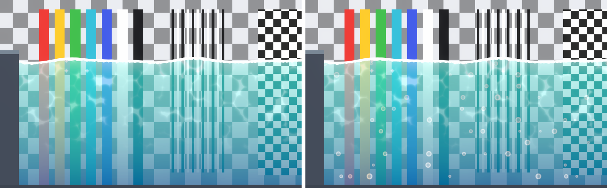

Small bubbles rising to the surface.

| Property | What it does | Default | Typical |
|---|---|---|---|
| Bubbles | Turns the effect on. | off | |
| Bubble Color | Color; alpha is how visible they are. | white, alpha 0.6 | |
| Bubble Size | Average bubble radius; each bubble is 0.5–1.5 times this. | 0.06 | 0.03–0.12 |
| Bubble Density | How many bubbles. | 0.25 | 0.1–0.5 |
| Bubble Rise Speed | Rising speed. | 0.6 | 0.3–1.2 |
| Bubble Wobble | Side-to-side sway while rising. | 0.05 | 0–0.1 |

Cost: math only.

## Glints

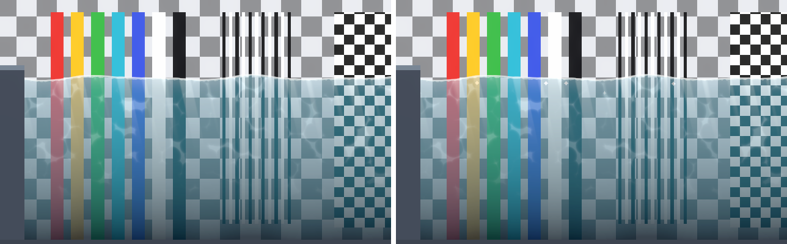

Sparkles that twinkle near the surface.

| Property | What it does | Default | Typical |
|---|---|---|---|
| Glints | Turns the effect on. | off | |
| Glint Color | Color. HDR: the default (3) glows with bloom. | HDR white ×3 | |
| Glint Density | How many sparkles. | 0.5 | 0.2–0.7 |
| Glint Size | Size of a sparkle. | 0.08 | 0.04–0.12 |
| Glint Speed | How fast they twinkle. | 2 | 1–4 |
| Glint Depth | How deep under the surface they appear. | 0.6 | 0.2–1 |

Cost: math only.

## Wall Foam

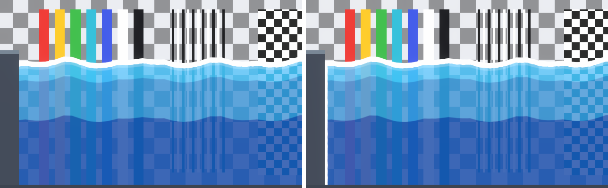

Foam where the water touches the sides of the body. Choose the sides on the Fluid Body
(**Wall Foam Sides**): turn a side off where the water continues off screen or joins another body.
Uses **Foam Color** from Surface.

| Property | What it does | Default | Typical |
|---|---|---|---|
| Wall Foam | Turns the effect on. | off | |
| Wall Foam Width | Width of the foam along each wall. | 0.25 | 0.1–0.4 |
| Wall Foam Breakup | How patchy it is. | 0.6 | 0.3–0.8 |

Cost: no extra samples while Surface is on (it reuses the foam noise); 1 sample with Surface off.

## Caustics

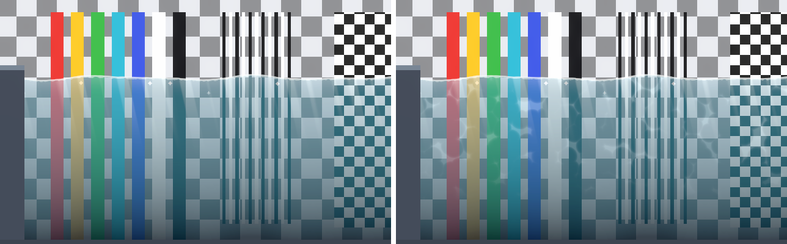

The moving net of light seen on shallow water.

| Property | What it does | Default | Typical |
|---|---|---|---|
| Caustics | Turns the effect on. | off | |
| Caustics Color | Color. HDR. | pale cyan | |
| Caustics Intensity | Brightness. | 0.8 | 0.4–1.5 |
| Caustics Scale | Size of the pattern. Smaller = larger cells. | 0.15 | 0.1–0.4 |
| Caustics Speed | How fast it moves. | 0.3 | 0.1–0.6 |
| Caustics Depth Fade | Depth where the caustics have faded out. | 3 | 1–5 |
| Caustics Sharpness | 1 = soft glow; 8 = thin bright lines. | 4 | 3–6 |

Cost: 2 samples.

## Pixel Art

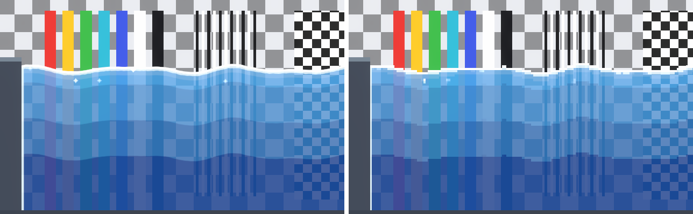

Snaps the whole water to a grid of world pixels, with a hard surface edge.

| Property | What it does | Default | Typical |
|---|---|---|---|
| Pixel Art | Turns the effect on. | off | |
| Pixels Per Unit | Size of the pixel grid. Use your sprites' Pixels Per Unit. | 16 | 8–32 |

Pair it with square splash particles; see [Water Styles — Pixel Art](water-styles.md#pixel-art).

Cost: math only.

## Bands

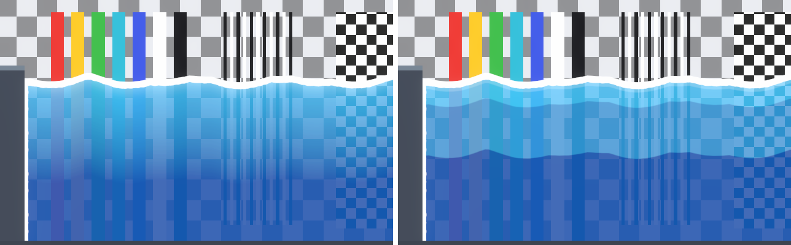

Flattens the water's depth gradient and reflection into a few bands, for cel-shaded and flat
styles. Foam, rays, caustics and glints are drawn on top and are not banded.

| Property | What it does | Default | Typical |
|---|---|---|---|
| Bands (header switch) | Turns the effect on. | off | |
| Bands (number) | Number of color bands. | 4 | 3–6 |
| Band Softness | 0 = hard steps; higher blends the steps. | 0 | 0–0.2 |

Cost: math only.

## Refraction

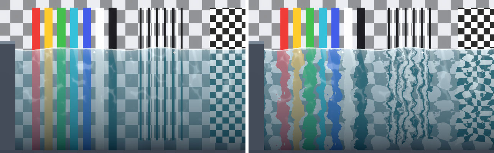

Bends what is behind the water. It needs one-time project setup: see
[Pipeline Setup — Refraction](pipeline-setup.md#refraction). Without it, the inspector shows a
warning and a button that does the setup for you. The image uses a Refraction Strength of 0.03.

| Property | What it does | Default | Typical |
|---|---|---|---|
| Refraction | Turns the effect on. | off | |
| Refraction Strength | How far the background is pushed, as a fraction of the screen. | 0.015 | 0.005–0.03 |
| Refraction Scale | Frequency of the distortion: higher gives smaller, finer ripples. | 0.5 | 0.3–1 |
| Refraction Speed | How fast it moves. | 0.2 | 0.1–0.5 |

Cost: 2 samples (the screen copy and its distortion noise), plus the screen copy itself ([Performance](performance.md)).

## Lighting

How the water reacts to 2D lights.

| Property | What it does | Default | Typical |
|---|---|---|---|
| Light Effects Glow | How much the light effects (caustics, rays, highlight, glints) shine on their own. 0 = they darken with the 2D lights like the rest of the water; 1 = they glow, even at night. | 0 | 0–1 |
| Ignore 2D Lights | Draws the water at full brightness, ignoring 2D lights. | off | |

Cost: math only.
