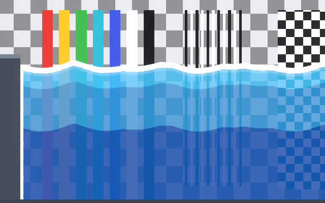
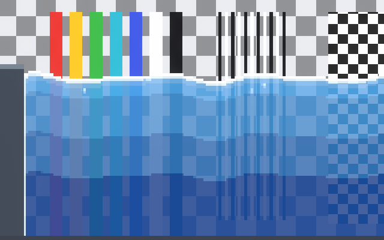
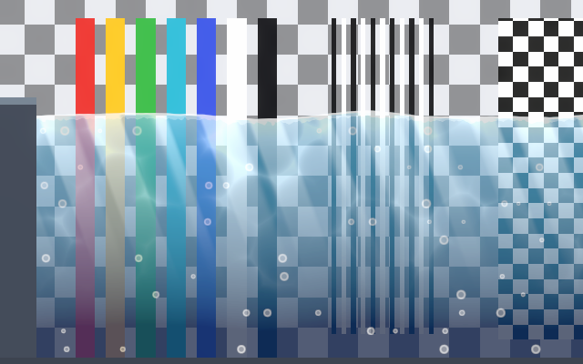
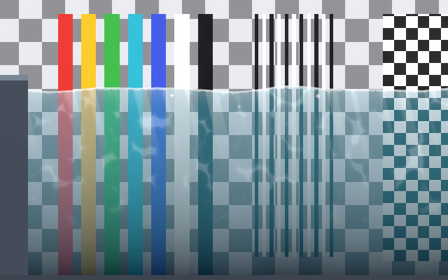
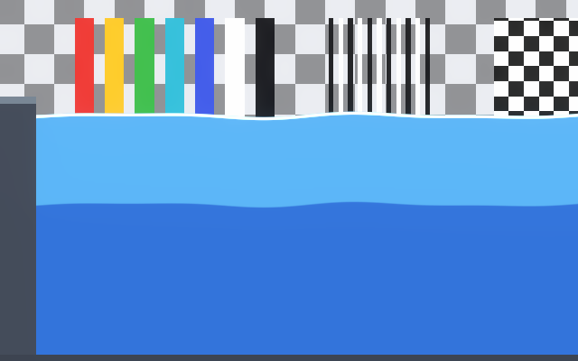
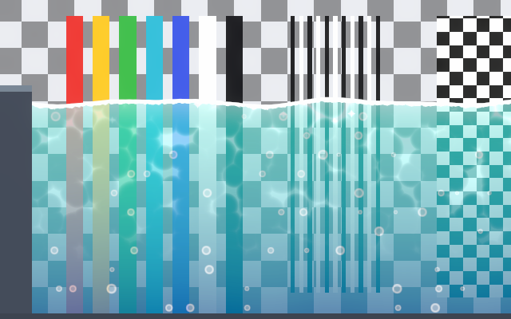
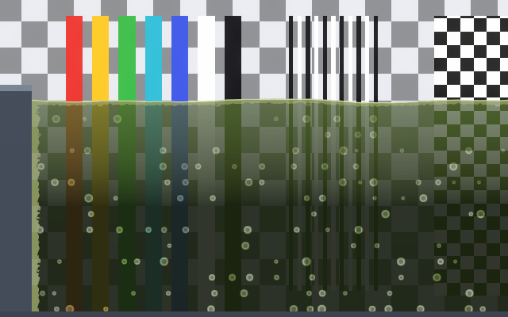
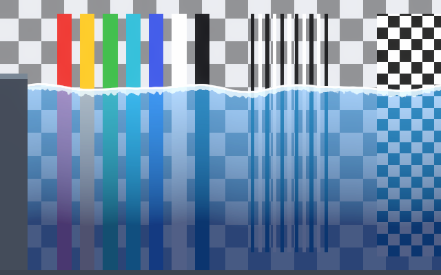

# Water Styles

Each preset is a finished look and a starting point. Pick the closest one with **Style Preset** in
the material inspector, then adjust it to your art (see [Presets](presets.md) for how presets work).
Effect names below are the switches described in [Water Effects](water-effects.md).

| Preset | Effects on |
|---|---|
| Cartoon | Surface, Reflection, Wall Foam, Bands |
| Pixel Art | Surface, Reflection, Glints, Wall Foam, Pixel Art, Bands |
| Painted | Surface, Reflection, Light Rays, Bubbles, Caustics |
| Realistic | Surface, Reflection, Light Rays, Glints, Caustics |
| Flat | Surface, Bands |
| Tropical | Surface, Reflection, Bubbles, Glints, Caustics |
| Swamp | Surface, Bubbles, Wall Foam |
| Simple | Surface |

General advice for every style:

- **Colors first.** Take Shallow Color and Deep Color from your palette, then set Depth Fade
  Distance to about half the depth of your typical water.
- **Match the waves to your scale.** Wave Length around 2–3 times your character's height reads
  well; Wave Height around a tenth of it.
- **One accent at a time.** Add or remove a single effect, check, then move on.

## Cartoon

Bold colors, sharp crests and a thick white line.

- Wave Sharpness 0.7–1 for pointed crests; Highlight Thickness 0.05–0.08.
- Bands with 3–4 Bands and Band Softness 0 give clean cel-shaded steps.
- Keep Wall Foam on where the water meets ground, so the edges read.

## Pixel Art

Every part of the water snaps to the same pixel grid as your sprites.

1. Set **Pixels Per Unit** to your sprites' Pixels Per Unit (16 in the preset).
2. Add a **Pixel Perfect Camera** to your camera and set its *Assets Pixels Per Unit* to the same
   value. Without it, water pixels and sprite pixels can drift apart while the camera moves.
3. Use square droplets: drag `Prefabs/WaterSplash_Pixel` into the Hierarchy under the water, then
   assign that instance to **Particles** on the Fluid Splash Particles component (you can delete the
   round *WaterSplash* child).
4. Keep Glint Size close to one or two pixels (1 ÷ Pixels Per Unit), and use few Bands (3–4) for a
   limited palette.

## Painted

Soft, layered light, like an illustrated background.

- Light Rays with a low Rays Intensity (0.2–0.4) and soft Caustics (Caustics Sharpness 2–3).
- Wave Irregularity around 0.5 hides the regular rhythm of the waves.
- Light Effects Glow (0.6 in the preset) keeps the light glowing in darker scenes; lower it if the water should darken more at night.

## Realistic

Clear water with caustics, light rays and sparkles.

- Low Shallow Color alpha (0.3–0.5) so the background shows through.
- Turn on **Refraction** for the full effect (needs one-time setup: [Pipeline Setup](pipeline-setup.md#refraction)).
  Keep Refraction Strength small, 0.005–0.015.
- Add bloom to your camera so HDR glints and highlights glow (the showcase scene has an example
  Volume).

## Flat

Minimal vector look: two or three solid colors.

- Wave Irregularity 0 and Wave Sharpness 0 give an even, calm line.
- Bands with 2–3 bands. The preset already has Foam Width 0, so there is no foam band.

## Tropical, Swamp and Simple

- **Tropical** shows how far color alone goes: turquoise shallows, deep blue below, caustics and glints.
- **Swamp** is murky: high Deep Color alpha, a short Depth Fade Distance, slow green bubbles.
- **Simple** has only the surface. It is the cheapest preset and a clean base to build your own.

